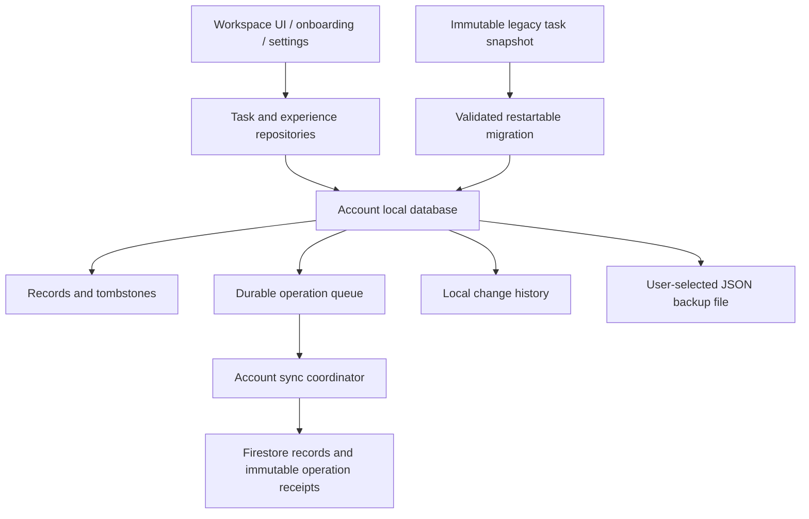

# Productivity architecture — implementation in progress

This document describes the new code under `lib/src/productivity`. The running
application still enters the legacy shell. This is a development checkpoint,
not a release-readiness claim. The complete target remains `gap.md`; the
requirement ledger is `docs/gap-implementation-status.md`.

## Boundaries

- Generic storage owns atomic record, logical clock, queue and audit writes.
- Domain commands read and validate relationships inside the same transaction as
  their writes. A UI does not send an old full task object over a later edit.
- A session owns its database and coordinator. Sign-out retains offline work;
  account deletion freezes writes, drains active work and removes the local file.
- Faith data remains in its existing collections until each adapter is migrated.
  No migration deletes the source data.

## Local data and sync

`ProductivityDatabase` uses Sembast files on IO platforms and Sembast IndexedDB
on web. Each account has a hashed database name, an owner binding and a random
device identity. Records, tombstones, outbox, metadata and changes are separate
stores. An edit returns only after its local transaction commits.

Each field carries a Lamport counter and device ID. Independent field edits
merge; concurrent changes to the same field resolve deterministically. The
losing fields remain in the audit receipt and a durable local conflict store.
The sync sheet presents both values and asks the owner to keep the cloud value
or send the local value with a fresh logical clock. A newer cloud edit makes an
open review choice stale and requires another look; a later intentional local
edit clears its older conflict. Task choices run through task relationship
validation. Other supported record types run through backup-domain validation;
future record types still need validators. This is not a text CRDT or an
end-to-end encrypted database.

Firestore stores canonical records at `users/{uid}/productivity/{kind--id}` and
immutable receipts at `users/{uid}/productivityChanges/{operationId}`. A receipt
fingerprint makes an ambiguous network retry idempotent. Server timestamps plus
document IDs form the pull cursor. Acknowledging one operation never removes a
later queued edit.

Task writes also update `productivityGraph/{taskId}` and the single
`productivityControl/taskGraph` revision in the same Firestore transaction.
Security rules require the canonical task, graph projection and revision to
match. The official client reads a stable paginated graph snapshot, validates
the merged dependency/parent graph, then checks the revision inside its write
transaction. A changed revision triggers bounded reload and retry. A graph
conflict leaves its original outbox operation and later edits intact for review;
other records can continue syncing. The user can edit the task and explicitly
resubmit only its unsent fields. Superseded operations remain in local history.
The graph guard relies on the official client for whole-graph cycle detection;
Firestore rules cannot traverse a large graph. An Android emulator integration
test verified two signed-in Dart clients, a merged cycle rejection, review and
resubmission against local Auth and Firestore emulators. Larger graphs,
interrupted retries and real-device reconnection still need verification.

Generated/imported records use create-only operations. A stale device cannot
overwrite an existing recurring completion with its initialization defaults.
Later intentional edits remain ordinary field patches.

The coordinator bounds batches, persists retry delays, times out requests,
invalidates late responses on pause/sign-out, and freezes when the server reports
account deletion. Current automatic sync runs in the foreground. Background
execution and production telemetry remain to be implemented and verified.

### Storage limitations to resolve

- Sembast IO keeps its database in memory and requires one process/isolate
  owner. Do not add background writers to the current file factory. Select and
  verify an indexed storage backend before claiming large-scale/background
  reliability. Web transactions can retry; planners must be pure.
- General records are bounded to 256 KiB. JSON backups are bounded to 25 MiB and
  20,000 records. Backup format 2 preserves open field conflicts and accepts
  older format 1 files. Larger archives and attachments need a separate
  streaming path.
- On-device encryption, sensitive-note protection and key recovery are not
  implemented. The native application sandbox is not an encryption claim.
- The graph revision and rules pairing have emulator coverage, while merged
  offline graph cases have pure Dart and Android emulator coverage. Physical
  devices, long-running reconnection and larger graph behavior remain open.
  Conflict review for future record kinds and long-running reconnection remains
  open.

See the [Sembast documentation](https://pub.dev/documentation/sembast/latest/index.html),
[Sembast web package](https://pub.dev/packages/sembast_web), and Flutter's
[offline-first architecture guidance](https://docs.flutter.dev/app-architecture/design-patterns/offline-first).

## Tasks, projects and recurrence

Tasks separate availability date, all-day planned date, scheduled instant and
hard deadline. Moving a task does not move its deadline. Estimates, tags,
priorities, descriptions, references, reminders, status and postponement count
are stored independently.

Hierarchy and prerequisites are checked together. A child depending on its own
parent is rejected even though separate hierarchy/dependency checks would miss
that cycle. Open prerequisites/subtasks prevent completion. Trashing a parent
trashes descendants atomically; undo restores the matching deletion clocks and
does not undo a later deletion.

Recurring tasks have independent `TaskOccurrence` records. Merely viewing dates
does not enqueue records. Previous check-ins survive later series edits or
pauses. The rule supports intervals, weekdays, month days, negative month days,
end/count bounds, exceptions, pauses and short-month policy.

Civil dates use date arithmetic independent of DST day length. Named-zone wall
time conversion returns no candidates for a spring gap and both candidates for
a fall overlap. The editor asks the user to resolve an overlap; it does not
silently shift a nonexistent meeting time.

The Tasks screen's Today view now sums scheduled task estimates across every
enabled non-Faith workspace in the configured time zone. It counts active
recurring occurrences, excludes completed and archived work, and does not
mistake a deadline for scheduled effort. The daily ceiling is the smaller of
the user's task-capacity setting and workday span; a nonworking day has zero
planned capacity. Local calendar events reduce that ceiling once per occupied
minute, even when events overlap. The card warns on an overrun and calls out
tasks without an estimate. Buffers and externally imported commitments remain
outside this estimate; broader planning requirements remain open.

Open one-off tasks can be moved to tomorrow from the task action menu. This
stores a civil day rather than inventing a wall-clock instant, increments the
postponement count once, keeps the original deadline, and avoids repeating an
identical move. A confirmation is required when the new day is after the
deadline in the user's configured time zone. The action is hidden for
completed, recurring and already-future tasks. Reminder snoozing and richer
recovery planning remain separate work.

## Migration and account preservation

1. The Firestore adapter reads the account deletion marker and legacy task
   snapshot in a transaction.
2. It validates the entire deterministic plan before setting
   `productivityMigrationVersion: 1` on the source.
3. Rules freeze that source against stale updates and delete/recreate attempts.
4. Local batches create tasks, recurring series, occurrences and Unicode-safe
   source archive parts with stable IDs and create-only semantics.
5. The local completion checkpoint is written after all batches. Interrupted
   batches replay without overwriting later edits. A changed frozen source
   checksum is rejected.

Original bucket/section/creation metadata is retained. The importer does not
invent completion timestamps or convert a soft scheduled day into a deadline.
An orphan recurring instance remains a recoverable standalone task.

The fence and adapter are **not deployed or called by the legacy UI**. Main-shell
cutover, growth/checklist migration, native migration testing and route coverage
remain open. Do not activate the fence before replacing every legacy task write
route and preparing account-deletion/privacy assets.

## Preferences and UI

Experience preferences hold language, modules, theme, working hours, working
days, capacity, clock format, week start, timezone and active workspace. Setup
commits choices and workspaces atomically. Disabling a module retains its data.

New onboarding defaults to Personal with Faith off. Work, Study and Wellness are
independent choices. The new task UI provides inbox/today/upcoming/all/completed/
trash views, search, project filters, a persistent mobile save action, subtask
entry, status actions, recurrence and dependency editing. Bangla uses Anek Bangla
and supports Bangla numeric input. The rest of the application still needs full
localization and integration with this root experience.

The universal root now starts at a cross-workspace Inbox. It shows open,
unorganized tasks from enabled non-Faith workspaces, provides search and
workspace filters, and lets the user choose the destination workspace before
capturing a task. Editing an Inbox item opens the editor in its original
workspace. Completed, archived, planned and deleted tasks do not appear. A
320 px enlarged-text widget flow saves a new item to the selected workspace;
390 px Bengali and English previews pass label and tap-target checks. This
surface is still hidden behind the legacy app entry and is not counted as a
finished requirement in the gap ledger.

The Inbox and Tasks screens retain their add actions. The root also exposes
quick add from Faith and Settings, using the active workspace and loading its
current tasks/projects from the local account database before opening the
editor. The route checks that its session is still active after the read, so a
late account switch cannot open another user's task form. Widget tests cover
both entry points; the shipped legacy shell still has its separate add flow.

The universal root now has a default Faith adapter for the existing Prayer,
Quran, Dhikr, Growth and Dua screens. It opens those screens lazily, tracks a
local day rollover and keeps legacy task routes out of the Faith area. Its
legacy repository must belong to the same signed-in account. Existing
emergency contacts remain reachable from Settings through that repository.
The root owns legacy notification refresh: with Faith on, only prayer and growth daily reminders
may be scheduled; the old task reminder is cancelled. Turning Faith off
cancels the daily and prayer-time alerts without deleting Faith history.
Changing this option and its notification behavior have widget coverage. The
main app still enters `HomeShell`, so this adapter does not yet appear in the
release APK. Existing Faith screen content is still Bengali-only; English
localization remains open.

Backup export/import uses the native picker through a testable gateway. Import
checks owner, schema, checksum, duplicates, record types and history identities
before writes. A recomputed checksum cannot bypass task field validation.
Cancelled pickers do not report success. Exported JSON is explicitly described
as unencrypted. Native picker behavior still needs emulator/device verification.
The [file picker API](https://pub.dev/packages/file_picker) supports the target
platforms, but that package support is not app-level platform verification.

The hidden root now includes a Calendar tab. Locally owned events use UTC
start/end instants plus an IANA time zone and workspace identity. The editor
rejects missing DST hours and asks which instant a repeated hour means; its
save action stays visible at narrow phone widths. The day list spans events
that cross midnight, displays enabled workspaces together, and flags overlaps
using half-open intervals. Create/edit/delete commit through the local outbox,
and backup import validates event fields. A 320 px enlarged-text widget test
covers conflict display and a real edit. This is a local event slice: weekly
grid, external calendar accounts, reminders and automatic scheduling remain
unimplemented, and the shipped main entry still uses the legacy shell.

Event start/end/zone now share one versioned `interval` field, so two devices
cannot combine independently edited endpoints into an invalid event. The
reader accepts the previous hidden-preview fields for backup recovery. Local
remote-page merge and Firestore transaction writes validate the event before
commit; Firestore rules require a canonical fixed-width UTC interval and
reject reversed or malformed values. Tests cover concurrent endpoint edits,
atomic rollback of an invalid pull page, and 14 Auth/Firestore emulator cases.
These rules remain undeployed until the broader root cutover is ready.

The sync sheet now lets the owner open a failed calendar event, correct it,
review the resubmission, and replace its rejected outbox operations with one
fresh patch. The immutable audit history names the superseded operations.
Field conflicts show the interval as localized dates and times. A rejected
event no longer holds unrelated task writes in the same sync batch. Repository,
coordinator and 320 px enlarged-text widget tests cover this recovery path.
The event editor submits only fields the owner changed, so saving a stale form
does not revert a concurrent edit to another field. Bangla date digits, event
times and workspace names are localized in the day list; narrow-phone widget
tests cover both the concurrent edit and Bangla display.

An optional hourly day view now lays local events and scheduled tasks with time
estimates on an elapsed-time grid with separate horizontal lanes for overlaps.
It clips blocks at local day boundaries,
uses 23/25-hour grids across daylight-saving changes, marks the current time,
and opens near the first upcoming event or the current hour. Narrow-phone,
enlarged-text and DST widget tests cover this view. The agenda remains
available from the same calendar switch. Tasks without estimates or a clock
time are not assigned a fabricated block. Event and task blocks have distinct
colors and open their respective editors. External calendar integration and
drag-to-reschedule remain unimplemented.

Today task capacity now subtracts the union of local calendar commitments
inside the configured workday from the user's daily task budget. Overlapping
events count once; workspaces disabled in preferences are excluded. A DST
transition uses actual elapsed time between resolved workday boundaries.
External calendars, travel buffers and automatic task placement are still
outside this capacity estimate.

## Verification scope

- Unit/widget tests exercise real local transactions and files, two-client
  convergence, retry idempotency, lifecycle interruption, migration replay,
  hierarchy/dependency cycles, recurrence, backup validation, onboarding and
  phone-width/large-text task capture. Conflict tests also cover restart,
  stale review choices, explicit retry, backup preservation and a Bangla phone
  dialog. Faith adapter tests cover lazy tab navigation, account-independent
  legacy task exclusion, date rollover at 320 px with enlarged text, and
  root-level reminder cancellation when Faith is turned off.
- Firebase emulator tests use synthetic `demo-ummah` accounts only. They exercise
  owner rules, immutable receipts, deletion batches and the legacy write fence.
- An Android emulator test uses two signed-in Dart clients to verify graph
  conflict recovery and same-field rejection, review and retry against local
  Firebase emulators. It does not represent a physical-device reconnection test.
- The signed build 3 APK passed startup/login on Android API 36 x86_64 with
  16 KiB pages before the productivity changes. The later APK with the new
  native plugin also passed signature, 16 KiB alignment and clean-start login
  checks on that emulator (`docs/release/productivity-packaging-smoke.json`).
  Its main entry still uses the legacy shell; this is a packaging check.
- Physical Android and iOS testing is unavailable per the user. iOS/platform
  implementation and all release gates remain open where evidence is missing.
