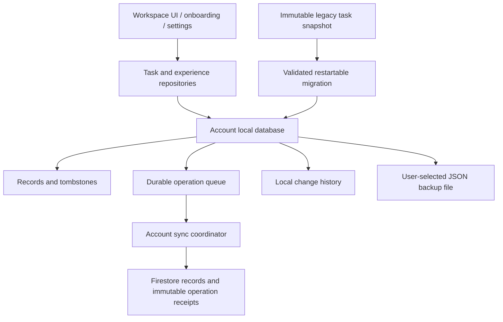

# Productivity architecture — implementation in progress

This document describes the new code under `lib/src/productivity`. The running
application still enters the legacy shell. This is a development checkpoint,
not a release-readiness claim. The complete target remains `gap.md`; the
requirement ledger is `docs/gap-implementation-status.md`.

## Boundaries

- Generic storage owns atomic record, logical clock, queue and audit writes.
- Domain commands read and validate relationships inside the same transaction as
  their writes. A UI does not send an old full task object over a later edit.
- A session owns its database and coordinator. Sign-out retains offline work;
  account deletion freezes writes, drains active work and removes the local file.
- Faith data remains in its existing collections until each adapter is migrated.
  No migration deletes the source data.

## Local data and sync

`ProductivityDatabase` uses Sembast files on IO platforms and Sembast IndexedDB
on web. Each account has a hashed database name, an owner binding and a random
device identity. Records, tombstones, outbox, metadata and changes are separate
stores. An edit returns only after its local transaction commits.

Each field carries a Lamport counter and device ID. Independent field edits
merge; concurrent changes to the same field resolve deterministically. The
losing fields remain recorded in the change receipt. A full conflict review UI
is still required. This is not a text CRDT or an end-to-end encrypted database.

Firestore stores canonical records at `users/{uid}/productivity/{kind--id}` and
immutable receipts at `users/{uid}/productivityChanges/{operationId}`. A receipt
fingerprint makes an ambiguous network retry idempotent. Server timestamps plus
document IDs form the pull cursor. Acknowledging one operation never removes a
later queued edit.

Generated/imported records use create-only operations. A stale device cannot
overwrite an existing recurring completion with its initialization defaults.
Later intentional edits remain ordinary field patches.

The coordinator bounds batches, persists retry delays, times out requests,
invalidates late responses on pause/sign-out, and freezes when the server reports
account deletion. Current automatic sync runs in the foreground. Background
execution and production telemetry remain to be implemented and verified.

### Storage limitations to resolve

- Sembast IO keeps its database in memory and requires one process/isolate
  owner. Do not add background writers to the current file factory. Select and
  verify an indexed storage backend before claiming large-scale/background
  reliability. Web transactions can retry; planners must be pure.
- General records are bounded to 256 KiB. JSON backups are bounded to 25 MiB and
  20,000 records. Larger archives and attachments need a separate streaming path.
- On-device encryption, sensitive-note protection and key recovery are not
  implemented. The native application sandbox is not an encryption claim.
- Local transactions reject cyclic task graphs, but concurrent graph edits from
  different offline devices can still introduce a cycle after cloud merge. A
  server-guarded graph revision and conflict/recovery UI are required before
  enabling the new task engine for existing accounts. Independent-field sync
  convergence tests do not prove this cross-record invariant.

See the [Sembast documentation](https://pub.dev/documentation/sembast/latest/index.html),
[Sembast web package](https://pub.dev/packages/sembast_web), and Flutter's
[offline-first architecture guidance](https://docs.flutter.dev/app-architecture/design-patterns/offline-first).

## Tasks, projects and recurrence

Tasks separate availability date, all-day planned date, scheduled instant and
hard deadline. Moving a task does not move its deadline. Estimates, tags,
priorities, descriptions, references, reminders, status and postponement count
are stored independently.

Hierarchy and prerequisites are checked together. A child depending on its own
parent is rejected even though separate hierarchy/dependency checks would miss
that cycle. Open prerequisites/subtasks prevent completion. Trashing a parent
trashes descendants atomically; undo restores the matching deletion clocks and
does not undo a later deletion.

Recurring tasks have independent `TaskOccurrence` records. Merely viewing dates
does not enqueue records. Previous check-ins survive later series edits or
pauses. The rule supports intervals, weekdays, month days, negative month days,
end/count bounds, exceptions, pauses and short-month policy.

Civil dates use date arithmetic independent of DST day length. Named-zone wall
time conversion returns no candidates for a spring gap and both candidates for
a fall overlap. The editor asks the user to resolve an overlap; it does not
silently shift a nonexistent meeting time.

## Migration and account preservation

1. The Firestore adapter reads the account deletion marker and legacy task
   snapshot in a transaction.
2. It validates the entire deterministic plan before setting
   `productivityMigrationVersion: 1` on the source.
3. Rules freeze that source against stale updates and delete/recreate attempts.
4. Local batches create tasks, recurring series, occurrences and Unicode-safe
   source archive parts with stable IDs and create-only semantics.
5. The local completion checkpoint is written after all batches. Interrupted
   batches replay without overwriting later edits. A changed frozen source
   checksum is rejected.

Original bucket/section/creation metadata is retained. The importer does not
invent completion timestamps or convert a soft scheduled day into a deadline.
An orphan recurring instance remains a recoverable standalone task.

The fence and adapter are **not deployed or called by the legacy UI**. Main-shell
cutover, growth/checklist migration, native migration testing and route coverage
remain open. Do not activate the fence before replacing every legacy task write
route and preparing account-deletion/privacy assets.

## Preferences and UI

Experience preferences hold language, modules, theme, working hours, working
days, capacity, clock format, week start, timezone and active workspace. Setup
commits choices and workspaces atomically. Disabling a module retains its data.

New onboarding defaults to Personal with Faith off. Work, Study and Wellness are
independent choices. The new task UI provides inbox/today/upcoming/all/completed/
trash views, search, project filters, a persistent mobile save action, subtask
entry, status actions, recurrence and dependency editing. Bangla uses Anek Bangla
and supports Bangla numeric input. The rest of the application still needs full
localization and integration with this root experience.

Backup export/import uses the native picker through a testable gateway. Import
checks owner, schema, checksum, duplicates, record types and history identities
before writes. A recomputed checksum cannot bypass task field validation.
Cancelled pickers do not report success. Exported JSON is explicitly described
as unencrypted. Native picker behavior still needs emulator/device verification.
The [file picker API](https://pub.dev/packages/file_picker) supports the target
platforms, but that package support is not app-level platform verification.

## Verification scope

- Unit/widget tests exercise real local transactions and files, two-client
  convergence, retry idempotency, lifecycle interruption, migration replay,
  hierarchy/dependency cycles, recurrence, backup validation, onboarding and
  phone-width/large-text task capture.
- Firebase emulator tests use synthetic `demo-ummah` accounts only. They exercise
  owner rules, immutable receipts, deletion batches and the legacy write fence.
- The signed build 3 APK passed startup/login on Android API 36 x86_64 with
  16 KiB pages. That APK predates the productivity changes and added plugins.
- Physical Android and iOS testing is unavailable per the user. iOS/platform
  implementation and all release gates remain open where evidence is missing.
