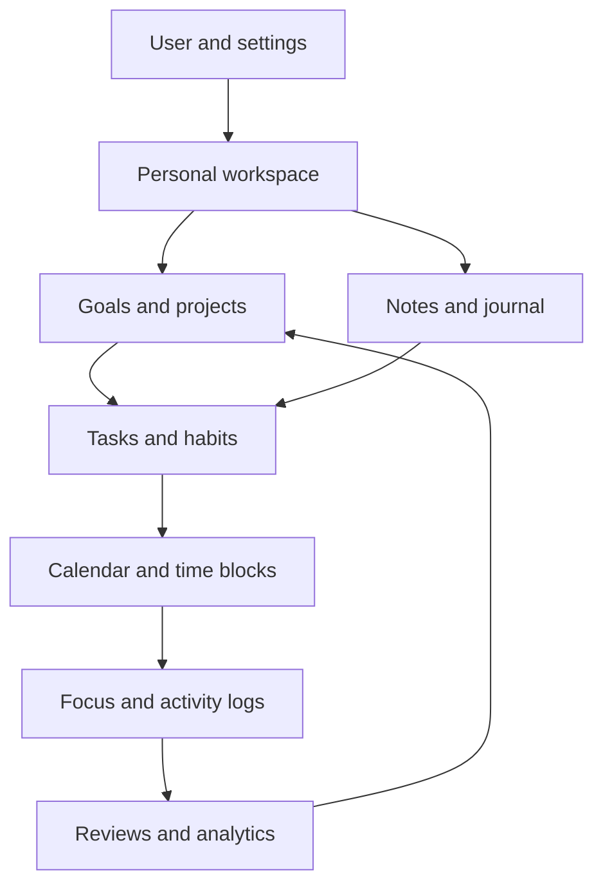

# রবের পথে: Global Productivity App Competitive Gap Analysis

**Market research | 30 October 2026 | Strategic product audit**

**My conclusion: রবের পথে has a solid foundation, but it is still far from competing with the strongest international productivity apps.**

The good news is that you already have several valuable building blocks: daily tracking, recurring tasks, personal growth checklists, historical records, progress reports, notifications, user accounts, and cloud synchronization.

The problem is that these features primarily help users **record what they have done**.

The best productivity products help users decide:

1. What should I accomplish?
2. What matters most?
3. When will I do it?
4. How do I avoid distractions?
5. What happens when my plans change?
6. Am I actually progressing toward my goals?
7. What should I do differently tomorrow?

Your next product should answer all seven questions.

## 1. The product I recommend building

**PROPOSED PRODUCT POSITIONING**

### Your Personal Productivity Operating System

One intelligent place to manage your tasks, calendar, goals, habits, focus, knowledge, and personal growth.

1. Capture
2. Plan
3. Execute
4. Track
5. Reflect
6. Improve

One connected system, with optional modules for work, study, personal life, wellness, and spirituality.

I would shift your product strategy from an Islamic daily tracker to a universal personal productivity platform.

The existing prayer, Quran, and other religious features can remain available through an optional Faith module. They do not need to define the experience for everyone.

For example, an American software engineer should be able to download the app, choose "Work and Personal Productivity," and immediately start managing meetings, deadlines, projects, exercise, habits, and personal goals without encountering religious onboarding.

A Muslim user could enable the Faith module and access those additional features within the same productivity engine.

That architectural separation is important.

---

## 2. Competitive research: 31 major productivity apps

I examined the published feature sets of 31 established products across seven categories. The comparison uses their official product pages and documentation, checked on 30 October 2026.

This is a broad market benchmark, not an assertion that these are every productivity app in existence.

### A. Traditional task managers

These apps establish what users expect from a capable to-do system.

| Competitor | What it does well | Gap in রবের পথে |
|---|---|---|
| Todoist | Natural-language tasks, projects, priorities, subtasks, filters, labels, reminders, collaboration | Nearly all advanced task organization |
| TickTick | Tasks, calendar, habits, Pomodoro, Eisenhower Matrix, multiple views | Integrated execution and planning tools |
| Things 3 | Elegant task organization, areas, projects, Today, Anytime, Someday | Intentional workflow and project hierarchy |
| Microsoft To Do | My Day, lists, subtasks, Outlook integration, shared planning | Smart daily planning and email integration |
| Apple Reminders | Smart lists, tags, Siri capture, location triggers, shared lists | Quick capture and contextual reminders |
| Amazing Marvin | Deeply customizable workflows, procrastination tools, planning, timers | Personalization and adaptive productivity methods |

Todoist provides sophisticated task filtering and scheduling. TickTick combines task management with habits, focus timers, and calendar views. Amazing Marvin emphasizes modularity so users can activate only the strategies they need. [Official sources: Todoist, TickTick, Amazing Marvin]

**Biggest lesson:** Your existing must-do/good-to-do categories are too limited to replace a mainstream task-management system.

### B. Intelligent planning and calendar apps

These are especially important because they increasingly compete on helping users actually complete work.

| Competitor | What it does well | Gap in রবের পথে |
|---|---|---|
| Motion | Automatically schedules tasks, reprioritizes work, identifies deadline risk | Intelligent, capacity-aware scheduling |
| Reclaim.ai | Protects focus time, routines, buffers, and meeting availability | Adaptive calendar automation |
| Sunsama | Guided daily planning, weekly goals, shutdown rituals, timeboxing | Structured daily execution |
| Akiflow | Universal inbox, integrated calendars, command bar, planning rituals | Fast capture and unified planning |
| Structured | Visual daily timeline, calendar imports, AI-assisted task creation | Time-based daily visualization |
| Google Calendar | Events, scheduling, shared calendars, booking, availability, integration | Actual calendar and event management |

Motion's scheduling engine considers deadlines, duration, priorities, existing events, and working hours. Reclaim adjusts flexible calendar commitments as schedules change. Sunsama combines planning with daily review rituals, while Akiflow brings work from multiple tools into one inbox. [Official sources: Motion, Reclaim, Sunsama, Akiflow]

**Biggest lesson:** Having a calendar screen is not the same thing as having a scheduling system.

Your calendar currently lets users select dates and inspect historical records. It does not provide the functionality of a true calendar-based productivity application.

### C. Project management and all-in-one workspaces

| Competitor | What it does well | Gap in রবের পথে |
|---|---|---|
| Notion | Documents, databases, customizable views, knowledge management, AI | Connected information and flexible workspaces |
| ClickUp | Tasks, projects, goals, dashboards, time tracking, automations | Advanced project and goal execution |
| Asana | Projects, dependencies, goals, portfolios, resource management | Structured multi-step work |
| Trello | Visual Kanban boards, templates, automation, integrations | Visual project workflows |
| monday.com | Gantt charts, dashboards, milestones, workload management | Project planning and reporting |
| Linear | Project cycles, initiatives, planning, insights, structured workflows | Execution history and sophisticated progress measurement |

Notion links documents and databases with task workflows. ClickUp connects tasks, time estimates, dependencies, and goals. Asana and monday.com add project-level planning and resource visibility. [Official sources: Notion, ClickUp, Asana, monday.com]

**Biggest lesson:** রবের পথে can manage individual tasks, but it lacks the organizational structure to manage complex goals and projects.

### D. Habit building, self-improvement, and motivation

| Competitor | What it does well | Gap in রবের পথে |
|---|---|---|
| Habitify | Flexible habit targets, streaks, mood tracking, detailed insights | Advanced habit management |
| Streaks | Simple habit tracking, Apple Health integration, flexible frequency | Habit automation and streaks |
| Habitica | RPG-style rewards, levels, quests, group accountability | Gamification and motivation |
| Finch | Daily goals, reflections, emotional check-ins, supportive rewards | Engaging self-improvement experience |
| Beeminder | Quantitative goals, progress forecasting, commitment mechanisms | Measurable, accountable goal tracking |

Habitify supports richer habit measurement and health integrations. Finch connects personal goals with reflection and encouragement. Habitica uses game mechanics, while Beeminder tracks progress against measurable commitments. [Official sources: Habitify, Finch, Habitica, Beeminder]

**Biggest lesson:** Your Growth feature has a useful foundation, but it behaves more like a daily checklist than a full habit-formation and personal-development system.

### E. Focus and time management

| Competitor | What it does well | Gap in রবের পথে |
|---|---|---|
| Forest | Focus timer, app blocking, rewards, visual progress | Distraction-resistant work sessions |
| Freedom | Scheduled app and website blocking, locked sessions | Digital distraction control |
| RescueTime | Automatic activity tracking, productivity analysis, goals | Actual time-use measurement |
| Toggl Track | Timers, automatic time tracking, estimates versus actual time | Effort measurement and time reporting |

Forest pairs focus sessions with visible rewards. RescueTime identifies time-use patterns, while Toggl measures planned versus actual work. [Official sources: Forest, RescueTime, Toggl]

**Biggest lesson:** Your app can track task completion, but cannot currently measure how much focused effort went into completing those tasks.

### F. Notes, journaling, and personal knowledge

| Competitor | What it does well | Gap in রবের পথে |
|---|---|---|
| Day One | Rich journaling, prompts, media, memories, encryption | Dedicated journaling and reflection |
| Obsidian | Linked notes, Markdown, graph view, plugins, local storage | Personal knowledge management |
| Evernote | Web clipping, document capture, organized notes | Information capture |
| Reflect | Daily notes, backlinks, audio capture, knowledge search | Connected notes and retrieval |

Day One includes journaling, memories, exports, and encryption. Obsidian supports linked knowledge, templates, and visual organization. [Official sources: Day One, Obsidian]

**Biggest lesson:** Your app asks people to develop themselves, but does not yet give them a proper space to think, write, store knowledge, and reflect.

---

## 3. Overall gap assessment

Based on your 12-page architecture catalogue, this is how the current application compares with the capabilities expected from a competitive general-purpose productivity platform.

Legend: Existing means documented as implemented; Partial means the foundations exist but the general productivity capability is incomplete; Gap means the capability is not documented in the supplied application inventory. This is not a fresh audit of the source code.

| Product area | Current position | Assessment |
|---|---|---|
| Basic task management | Create, complete, delete, schedule, repeat | Partial |
| Advanced task management | Projects, hierarchy, priorities, dependencies | Gap |
| Calendar and planning | Date selection, historical viewing | Partial |
| Calendar integration | Google, Outlook, Apple calendar sync | Gap |
| Automated scheduling | Dynamic calendar allocation and replanning | Gap |
| Habit management | Daily customizable growth checklists | Partial |
| Goal setting | Quran and Dhikr targets; general life goals not documented | Partial |
| Focus and time tracking | No dedicated focus or effort measurement | Gap |
| Journaling | No dedicated journal editor | Gap |
| Notes and knowledge | No general notes workspace | Gap |
| Productivity analytics | Prayer and growth reports, limited histories | Partial |
| AI assistance | No AI productivity engine documented | Gap |
| Integrations | Google authentication, but no work-tool connections documented | Gap |
| Collaboration | No shared productivity spaces documented | Gap |
| Notifications | Daily reminders and prayer alerts | Partial |
| Offline reliability | Firebase cache; no complete durable edit queue | Partial |
| Data security | Owner-scoped data and account deletion safeguards | Existing |
| Data portability | No general export/import | Gap |
| Internationalization | Bengali interface | Gap |
| Cross-platform availability | Android prerelease; iOS/web not fully validated | Partial |
| Personalization | Limited profiles and customizable checklists | Partial |

### Verdict

**Your largest weaknesses are interconnected.**

- Without projects and goals, users cannot organize meaningful long-term outcomes.
- Without real scheduling, they cannot confidently plan when work will happen.
- Without focus and time tracking, the app cannot measure execution.
- Without connected data and reviews, it cannot provide meaningful coaching.
- Without reliable offline editing and international accessibility, it cannot support a dependable global experience.

This does not mean the existing application should be discarded. It means the next version requires a stronger general productivity foundation.

## 4. Complete feature gap registry

This is the proposed development backlog. I have grouped the gaps into 14 systems so you can eventually convert them into GitHub issues, development sprints, and acceptance tests.

Priority definitions:

- **P0** Critical foundation or reliability requirement
- **P1** Essential to compete with mainstream productivity apps
- **P2** Advanced functionality for a premium experience
- **P3** Longer-term expansion or optional specialization

### A. Task management and capture

**P1: Major overhaul**

Your current task manager supports basic task operations, daily/weekly recurrence, scheduling, and missed-task carryover.

I recommend adding:

- [ ] Universal Inbox for capturing ideas and tasks without immediately organizing them.
- [ ] Natural-language input, such as "Send proposal to John next Friday at 3 PM."
- [ ] Voice-to-task creation.
- [ ] Quick Add available from anywhere in the application.
- [ ] Android sharing integration for creating tasks from links, text, and files.
- [ ] Projects and nested task groups.
- [ ] Subtasks and multilevel checklists.
- [ ] Four or five configurable priority levels.
- [ ] Tags, labels, and custom categories.
- [ ] Separate start date, scheduled date, and hard deadline.
- [ ] Time estimates for individual tasks.
- [ ] Advanced recurring schedules, including monthly, yearly, and custom intervals.
- [ ] Recurrence exceptions, skipping, and pausing.
- [ ] Multiple reminders per task.
- [ ] Snooze and postpone actions.
- [ ] Task descriptions, links, and attachments.
- [ ] Task templates and recurring checklists.
- [ ] Smart filters, saved searches, and custom task views.
- [ ] Bulk editing, duplication, moving, and archiving.
- [ ] Undo, recoverable trash, and edit history.
- [ ] Task statuses such as Not Started, In Progress, Waiting, Blocked, and Completed.
- [ ] Task dependencies and blocking relationships.

A task should eventually look something like this:

**High priority | In progress**

**Prepare quarterly business presentation**

Work / Business Development

| Property | Value |
|---|---|
| Deadline | Friday, 5 PM |
| Estimated effort | 180 minutes |
| Scheduled work | Thursday, 10 AM |
| Goal | Grow business revenue |

**Subtasks**

- [x] Collect financial information
- [ ] Prepare presentation outline
- [ ] Design presentation slides
- [ ] Review and rehearse

Focus session available

This is fundamentally more useful than a task containing only a title, category, and completion checkbox.

### B. Calendar and intelligent daily planning

**P1: Critical competitive gap**

This should be one of your highest priorities.

Add:

- [ ] Hourly day timeline.
- [ ] Weekly time-grid calendar.
- [ ] Monthly and yearly planning views.
- [ ] Integration with Google Calendar.
- [ ] Microsoft Outlook Calendar integration.
- [ ] Apple Calendar support through a suitable calendar connection.
- [ ] Multiple calendar accounts.
- [ ] Drag-and-drop task scheduling.
- [ ] Manual time blocking.
- [ ] Recurring focus blocks.
- [ ] Working hours and nonworking days.
- [ ] Scheduling buffers between commitments.
- [ ] Calendar conflict detection.
- [ ] Capacity calculation based on available time.
- [ ] Warnings when planned work exceeds available capacity.
- [ ] Priority-aware automatic task placement.
- [ ] Automatic rescheduling of incomplete work.
- [ ] Protected personal and family time.
- [ ] Travel-time allowances for location-based events.
- [ ] A daily planning assistant.
- [ ] A guided end-of-day shutdown.
- [ ] Weekly planning and review.
- [ ] Time zone and daylight-saving-time handling.
- [ ] Calendar event creation, editing, and synchronization.
- [ ] Separate display of externally imported events and internally planned work.

The key distinction is between a deadline and an execution plan.

For example:

"Finish the presentation by Friday" is a deadline.

"Work on the presentation Thursday from 10 AM to 12 PM" is an execution plan.

Your new system must understand both.

### C. Projects, workflows, and collaboration

**P1/P2**

For individuals and professionals, implement:

- [ ] Projects containing tasks, subtasks, and milestones.
- [ ] Personal workspaces such as Work, Personal, Study, and Family.
- [ ] Project status and progress tracking.
- [ ] Project descriptions, documents, and attachments.
- [ ] List, Kanban, calendar, and timeline project views.
- [ ] Task relationships and dependencies.
- [ ] Project templates.
- [ ] Milestone tracking.
- [ ] Project completion history.
- [ ] Shared projects and shared task lists.
- [ ] Task assignment to collaborators.
- [ ] Comments and mentions.
- [ ] Member permissions.
- [ ] Activity logs.
- [ ] Shared household or family planning.

I would defer enterprise resource planning, approval chains, complicated budgets, and advanced team administration until your personal productivity experience is mature.

Competing directly with enterprise project-management platforms would substantially expand the engineering and support burden.

### D. Advanced habits and routines

**P1**

You already have customizable growth checklists. Preserve that work and evolve it into a general-purpose habit engine.

Add:

- [ ] Standalone habit creation independent of checklist profiles.
- [ ] Daily, weekly, monthly, and custom habit frequency.
- [ ] Quantitative habits, such as reading 20 pages.
- [ ] Duration-based habits, such as exercising for 30 minutes.
- [ ] Reduction habits, such as limiting social media to 30 minutes.
- [ ] Habit streaks.
- [ ] Longest-streak and completion-consistency statistics.
- [ ] Habit heatmaps.
- [ ] Habit skipping and rest days.
- [ ] Temporary habit pausing.
- [ ] Flexible targets that change over time.
- [ ] Morning and evening routine builders.
- [ ] Habit stacking, where one activity triggers another.
- [ ] Habit reminders at appropriate times.
- [ ] Habit notes and reflections.
- [ ] Habit templates.
- [ ] Habit grouping by life area.
- [ ] Optional health-app integrations.
- [ ] Habit challenges with friends.
- [ ] Trend reports showing improvement over time.

One important design choice: a habit should not automatically be treated as a failure whenever a person intentionally rests.

For example, an exercise target of three days per week should be evaluated against that schedule, not against seven consecutive days.

### E. Goals and personal development

**P1: Essential**

This is one of the most significant strategic gaps.

A growth app needs to track outcomes, not only completed activities.

Add:

- [ ] Short-term and long-term goals.
- [ ] Weekly, monthly, quarterly, and annual goals.
- [ ] Goal categories such as Career, Health, Education, Finance, and Relationships.
- [ ] Goal descriptions and personal motivations.
- [ ] Measurable targets with units.
- [ ] Milestones.
- [ ] Goal progress percentages.
- [ ] Goal-to-project connections.
- [ ] Goal-to-task connections.
- [ ] Goal-to-habit connections.
- [ ] Automatic progress updates from completed activities.
- [ ] Manual progress logging.
- [ ] Goal deadlines.
- [ ] Goal trajectory and estimated completion.
- [ ] Goal review reminders.
- [ ] Paused, abandoned, and completed goal states.
- [ ] Annual personal development plans.
- [ ] Optional OKR-style planning.

For example:

**Read 24 books this year | Personal growth**

**8 of 24 books | 33%**

Illustrative goal example, not actual user data.

Connected activities:

- Read 20 pages daily.
- Complete one book approximately every two weeks.
- Write a short summary after finishing each book.
- Review reading progress every Sunday.

This establishes a meaningful connection between daily activities and long-term results.

### F. Focus, distraction management, and time tracking

**P1/P2**

Add:

- [ ] Pomodoro timer.
- [ ] Customizable work/break intervals.
- [ ] Stopwatch-based focus sessions.
- [ ] Focus sessions directly attached to tasks.
- [ ] Pause, resume, and interruption logging.
- [ ] Manual time entries.
- [ ] Planned versus actual effort.
- [ ] Focus-time goals.
- [ ] Deep Work mode.
- [ ] Full-screen, one-task-at-a-time interface.
- [ ] Break reminders.
- [ ] Optional ambient sounds.
- [ ] Focus history.
- [ ] Focus session tagging.
- [ ] Daily and weekly focus summaries.
- [ ] Distraction tracking.
- [ ] Optional app/website blocking, subject to operating-system capabilities.
- [ ] Optional desktop activity tracking.
- [ ] Privacy controls for automatic activity monitoring.
- [ ] Focus sessions involving accountability partners.

A useful distinction is between three independent metrics:

| Metric | Meaning |
|---|---|
| Task completion | Did the user finish the work? |
| Time invested | How much effort went into it? |
| Outcome progress | Did the work advance an important goal? |

A capable productivity system should measure all three without treating them as interchangeable.

### G. Journaling, notes, and knowledge management

**P1/P2**

You originally considered an Islamic journal. I would expand that concept into a general reflection and knowledge system.

Add:

- [ ] Daily journal entries.
- [ ] Rich-text or Markdown editor.
- [ ] Private journals and notebooks.
- [ ] Journal templates.
- [ ] Gratitude prompts.
- [ ] Daily accomplishments.
- [ ] Challenges and lessons learned.
- [ ] Mood and energy check-ins.
- [ ] Photos and attachments.
- [ ] Voice notes.
- [ ] Optional speech-to-text transcription.
- [ ] Meeting notes.
- [ ] Study notes.
- [ ] Linked notes and backlinks.
- [ ] Tags and folders.
- [ ] Full-text note search.
- [ ] Notes linked to tasks and goals.
- [ ] Convert highlighted text into tasks.
- [ ] Daily note and calendar integration.
- [ ] Journal history and memory resurfacing.
- [ ] Journal export.
- [ ] Biometric lock or additional protection for sensitive content.

Journaling should be an independent feature, not merely another checkbox named "Journal today."

### H. Productivity analytics and performance intelligence

**P1/P2**

Your current reports focus heavily on prayer and growth.

A general productivity application needs a wider measurement system.

Add:

- [ ] Task completion reports.
- [ ] Project progress reports.
- [ ] Habit consistency reports.
- [ ] Goal achievement reports.
- [ ] Focus-time reports.
- [ ] Estimated versus actual duration comparisons.
- [ ] Planned versus completed work.
- [ ] Overdue-task patterns.
- [ ] Task postponement frequency.
- [ ] Project workload distribution.
- [ ] Daily, weekly, monthly, quarterly, and yearly reporting.
- [ ] Calendar heatmaps.
- [ ] Personal productivity trends.
- [ ] Most productive time-of-day analysis.
- [ ] Focus versus interruption analysis.
- [ ] Goal contribution reports.
- [ ] Burnout-risk or overload indicators, carefully presented as workload signals rather than diagnoses.
- [ ] Weekly achievement summaries.
- [ ] Custom dashboard widgets.
- [ ] CSV and PDF report exports.
- [ ] Historical comparisons.
- [ ] Clear distinctions between missing data, skipped work, and actual failure.

I would avoid reducing everything to one arbitrary "productivity score." Users should be able to inspect the underlying measures and understand how conclusions were reached.

### I. AI and intelligent assistance

**P2: Major future opportunity**

AI can become a strong differentiator, provided it solves real planning problems.

Proposed features:

- [ ] Natural-language task capture.
- [ ] AI task breakdown.
- [ ] AI project-plan generation.
- [ ] Priority recommendations.
- [ ] Smart daily scheduling.
- [ ] Automatic replanning after disruptions.
- [ ] Scheduling conflict explanations.
- [ ] Workload prediction.
- [ ] Personalized daily briefing.
- [ ] Suggested next action.
- [ ] Task duplication detection.
- [ ] Deadline-risk warnings.
- [ ] AI-assisted weekly reviews.
- [ ] Journal summarization.
- [ ] Goal progress interpretation.
- [ ] Meeting-note summarization.
- [ ] Action-item extraction from notes and documents.
- [ ] Voice interaction.
- [ ] Natural-language search across the user's permitted data.
- [ ] Productivity coaching based on actual activity history.
- [ ] Suggested improvements to recurring routines.
- [ ] User approval before consequential AI changes.
- [ ] Undo support for approved AI actions.
- [ ] Clear explanations of AI recommendations.

For example, a user could ask:

> I have three deadlines this week, six hours of meetings, and I want to exercise four times. Can you help me make a realistic plan?

The system should inspect the relevant tasks, calendar commitments, available hours, and habits, then propose a schedule.

It must also be able to explain why it selected that schedule.

### J. Integrations and automation

**P2**

Integrations matter enormously for professionals because their tasks originate in many places.

Potential integrations:

| Category | Products or systems |
|---|---|
| Calendar | Google Calendar, Outlook Calendar, Apple Calendar |
| Email | Gmail, Outlook |
| Communication | Slack, Microsoft Teams |
| Documents | Google Drive, OneDrive |
| Project tools | Todoist, Trello, Asana, Notion |
| Health | Apple Health, Android Health Connect |
| Browser | Chrome and Firefox extensions |
| Automation | Zapier, Make, IFTTT |
| Device assistants | Siri Shortcuts, Android shortcuts |
| Developers | REST API, webhooks, potentially MCP |

Implement these progressively.

The initial priority should be calendar integration, followed by email capture and task import.

A full integration platform would introduce OAuth maintenance, conflict resolution, external API limits, and potentially significant backend costs.

### K. Social productivity and accountability

**P2/P3**

Add selectively:

- [ ] Shared goals.
- [ ] Accountability partners.
- [ ] Shared habit challenges.
- [ ] Private accountability groups.
- [ ] Progress sharing with user consent.
- [ ] Collaborative focus sessions.
- [ ] Family task lists.
- [ ] Encouragement and celebration.
- [ ] Optional achievement badges.
- [ ] Community challenges.
- [ ] Privacy controls for shared information.

A user should be able to remain entirely private. Social functionality should never be mandatory.

### L. User experience and global readiness

**P0/P1**

These gaps are particularly important if you want international adoption.

- [ ] Complete English-language interface.
- [ ] Bengali and English switching.
- [ ] Proper international date and number formatting.
- [ ] Configurable week start.
- [ ] Twelve-hour and twenty-four-hour clock formats.
- [ ] Correct daylight-saving-time handling.
- [ ] Country-specific holidays where enabled.
- [ ] Dark mode.
- [ ] System-theme following.
- [ ] Customizable home dashboard.
- [ ] Configurable navigation.
- [ ] Onboarding based on user goals.
- [ ] Starter templates for students, professionals, parents, and freelancers.
- [ ] Minimal interface for beginners.
- [ ] Advanced workspace for power users.
- [ ] Consistent empty, loading, and error states.
- [ ] Global search.
- [ ] Better keyboard shortcuts.
- [ ] Accessible text sizes and contrast.
- [ ] Screen-reader support.
- [ ] Home-screen widgets.
- [ ] Quick actions.
- [ ] Reduced-motion accessibility settings.
- [ ] Configurable notification frequency.
- [ ] Easy import from competing apps.

A sophisticated app should still be approachable.

Amazing Marvin's modular approach is especially relevant here. It supports many productivity methods without exposing all of them simultaneously. [Official source: Amazing Marvin]

### M. Platform support

**P1/P2**

To serve international consumers, plan for:

- [ ] Production-ready Android app.
- [ ] Production-ready iOS app.
- [ ] Full-featured web application.
- [ ] Tablet-responsive interface.
- [ ] Desktop application or installable web experience.
- [ ] Cross-device synchronization.
- [ ] Native notification behavior.
- [ ] Android home-screen widgets.
- [ ] iOS widgets.
- [ ] Android and iOS quick capture.
- [ ] Watch integrations where justified.
- [ ] Browser extension.
- [ ] Offline functionality across supported platforms.
- [ ] Cross-platform deep linking.

Do not treat the presence of Flutter source code as proof of release readiness. Each target platform needs its own verification.

### N. Reliability, privacy, and data ownership

**P0**

These items deserve the same attention as visible features.

- [ ] Durable offline task and habit editing.
- [ ] Local persistence for pending operations.
- [ ] Automatic synchronization after reconnection.
- [ ] Conflict-resolution rules.
- [ ] Duplicate-write protection.
- [ ] Reliable recurrence processing across time zones.
- [ ] Recoverable deleted tasks and notes.
- [ ] Data export in documented formats.
- [ ] Data import with validation.
- [ ] Reliable backups.
- [ ] Data migration between app versions.
- [ ] Account deletion verification.
- [ ] Protection against stale-account data appearing after sign-out.
- [ ] Sensitive-record access controls.
- [ ] Optional additional encryption for journals.
- [ ] Clear analytics and AI consent settings.
- [ ] Reliable notification rescheduling.
- [ ] Device-loss and reinstall recovery tests.
- [ ] Crash recovery and interrupted-save testing.
- [ ] Sync status visible to users.
- [ ] Automated monitoring for sync failures.
- [ ] Accessibility and performance regression tests.

Your existing account-deletion and owner-scoped security model is a good starting point. The next challenge is protecting a substantially larger and more interconnected data model.

---

## 5. The features that could make your app better than conventional competitors

Matching competitors is only the first objective.

If you implement a task manager, calendar, habit tracker, and journal separately, you will have several useful tools inside one app.

That alone does not create a superior product.

The stronger opportunity is making these capabilities understand and improve one another.

These are proposed differentiators. They are not claims that no competitor offers any similar functionality.

**1. Unified Goal-to-Execution System**

Every important task can connect to a project, goal, calendar block, focus session, and measurable outcome.

Users could see not merely what they finished, but which long-term goals their effort supported.

**2. Adaptive Reality-Based Planning**

The app considers actual availability, work duration, priorities, breaks, and existing commitments.

It warns users before they overcommit and offers revised plans when life changes.

**3. Personal Productivity Learning Engine**

The system learns from the user's permitted historical data.

For example, if a person repeatedly underestimates writing tasks, future estimates can be adjusted using actual completion history.

**4. Intelligent Recovery Mode**

When a user misses several days or falls behind, the app offers a manageable restart plan.

It can identify essential commitments, postpone less important work, and rebuild routines without unnecessarily punishing broken streaks.

**5. Future-Commitment Simulator**

Before accepting a new project or goal, users can ask:

"If I dedicate five hours a week to learning Spanish, what happens to my current schedule?"

The system previews potential time conflicts and tradeoffs before the user commits.

**6. Adjustable Automation**

Users choose how much control they delegate:

- Manual: the app records and organizes.
- Assisted: the app recommends changes.
- Automatic: the app adjusts explicitly authorized flexible commitments.

All important changes remain explainable and reversible.

The strongest potential differentiator is the combination of these systems, supported by accurate data and excellent usability.

## 6. Recommended technical architecture

Your current architecture uses Flutter, Firebase Authentication, Cloud Firestore, local preferences, and feature-specific domain logic.

That is sufficient for the present application, but I would revise the domain model before adding numerous interconnected features.

### Proposed core data model

The architecture should allow independent modules while preserving relationships among them.

Important proposed entities include:

| Entity | Purpose |
|---|---|
| `Task` | Persistent task identity, properties, and relationships |
| `TaskOccurrence` | Individual instances of recurring tasks |
| `Project` | Task groups, milestones, and project state |
| `Goal` | Measurable objectives and completion criteria |
| `GoalMetric` | Historical progress measurements |
| `Habit` | Routine definitions, frequencies, and targets |
| `HabitLog` | Individual observations and check-ins |
| `CalendarEvent` | Connected or locally owned calendar commitments |
| `TimeBlock` | Planned execution time |
| `FocusSession` | Actual time spent working |
| `Note` | Journal entries, meeting notes, and knowledge |
| `DailyReview` | Reflections and daily planning information |
| `IntegrationConnection` | External connection configuration and sync metadata |
| `ChangeEvent` | Auditable changes to important records |
| `SyncOperation` | Durable pending offline operations |

I would preserve the existing user records through a carefully tested migration rather than replace them abruptly.

### Three engineering decisions matter most

**First: Build a reliable offline-first write system.**

Firestore already provides local caching and offline support for many operations. However, its standard synchronization behavior does not automatically solve every conflict or every interrupted multi-step workflow. Your catalogue specifically notes the absence of a durable offline outbox for all edits.

For the expanded product, use a robust local persistence layer and explicitly designed synchronization semantics where necessary. [Official source: Firebase Firestore offline persistence]

**Second: Start with a deterministic scheduling engine.**

You can calculate a practical daily plan using availability, duration, priority, deadlines, dependencies, and scheduling preferences.

That does not inherently require an expensive language model.

Add AI later for natural-language understanding, recommendations, and complex explanation.

**Third: Separate personal productivity features from backend-dependent automation.**

Your preference to remain on Firebase Spark is reasonable for early development, but it creates constraints.

Firestore's documented free quota includes 50,000 document reads and 20,000 writes per day, applied at the project level. Cloud Functions for Firebase requires the Blaze plan. [Official sources: Firestore quotas and Cloud Functions quotas]

Therefore, advanced background integrations, server-driven AI, collaboration infrastructure, and cross-device automation may eventually require a paid backend.

Do not promise that every proposed feature can operate indefinitely at scale on the current free architecture.

---

## 7. The development roadmap I recommend

I would not implement every feature simultaneously.

Use this sequence.

### Phase 0: Stabilize the existing product

Verify Android startup, authentication, account switching, notifications, data integrity, offline behavior, and recovery. Add export capability and reliable operational diagnostics.

Exit condition: the existing core can be trusted on real devices.

### Phase 1: Build a competitive task and habit foundation

Implement projects, subtasks, priorities, tags, full recurrence, quick capture, richer habits, search, and English localization.

Exit condition: users can organize personal and professional tasks without another basic task manager.

### Phase 2: Add calendar and execution

Introduce day/week timelines, calendar integration, timeboxing, focus timers, duration estimates, and daily planning.

Exit condition: users can turn their task backlog into a realistic daily schedule.

### Phase 3: Connect goals, journals, and analytics

Build measurable goals, structured notes, daily reflection, historical reporting, and planned-versus-actual analysis.

Exit condition: daily execution is connected to measurable longer-term outcomes.

### Phase 4: Introduce intelligent assistance

Add scheduling recommendations, deadline-risk detection, automatic replanning, AI task breakdown, and personalized reviews.

Exit condition: the product improves plans using user data with clear explanations and user control.

### Phase 5: Expand the ecosystem

Add further integrations, collaboration, advanced automation, browser capture, and wider platform support.

Exit condition: the product fits naturally into users' existing workflows.

The roadmap is dependency-based, not a fixed calendar estimate. Actual delivery time depends on team size, engineering quality, and the scope you select within each phase.

## 8. What should the new home screen look like?

The current Home screen is organized partly around worship utilities.

For a universal productivity experience, I would make the primary dashboard actionable.

### Illustrative home screen

**THURSDAY, OCTOBER 29**

**Good morning, Alex**

Let's make today manageable.

| TASKS | FOCUS | HABITS |
|---|---|---|
| 4/7 | 95m | 3/5 |

**Your next priority | High**

**Finish project proposal**

10:00 AM to 11:30 AM

Explore focus experience

**Today's timeline**

| Time | Activity |
|---|---|
| 09:00 | Morning planning |
| 10:00 | Proposal deep work |
| 12:30 | Team meeting |
| 16:00 | Exercise |

Illustrative concept only, with fabricated example data.

The default home screen should answer three questions within seconds:

- What is most important right now?
- What is scheduled next?
- Am I making meaningful progress?

Detailed reporting, project configuration, and specialized modules should remain accessible without dominating the initial experience.

## 9. How should we measure whether it becomes a better app?

The number of implemented features is not a reliable measure of product quality.

I would define measurable acceptance criteria across five dimensions.

| Dimension | Suggested success measure |
|---|---|
| Activation | New users successfully create and schedule their first meaningful task |
| Planning | Users can build a realistic daily plan quickly |
| Execution | Users complete their selected priorities and log meaningful effort |
| Retention | Users find enough value to return across multiple weeks |
| Reliability | Task and habit changes survive offline periods, restarts, and synchronization |
| Trust | Users understand data handling and can export or delete their information |
| Usability | Core workflows remain accessible, responsive, and comprehensible |

The initial research and validation program should include both students and working professionals, particularly users already familiar with Todoist, TickTick, Motion, or similar applications.

Measure whether the new system improves their actual workflow, not simply whether they like the interface.

---

## 10. My final recommendation

Rakin, I think there is a genuine opportunity here, but I would make one major strategic decision before the next development cycle.

**Build the universal productivity engine first, then offer specialized experiences on top of it.**

My recommended hierarchy is:

**Universal Productivity Core**

Tasks, calendar, goals, habits, focus, notes, analytics

Optional experiences:

- Work
- Personal Life
- Study
- Wellness
- Faith
- Family

If you retain the name রবের পথে, I would consider positioning that as a specialized spiritual productivity experience built on the universal engine. A separately branded general-purpose product may be easier to communicate to users who have no connection to the religious concept.

### My first 10 development priorities

If I were setting the next development direction, I would prioritize these in order:

1. **Reliability and data safety**, including real-device testing and durable offline operations.
2. **English localization and universal onboarding**, so the app works for ordinary international users.
3. **Advanced task management**, including projects, subtasks, priorities, and flexible recurrence.
4. **A real calendar**, with Google Calendar integration and time blocking.
5. **Daily planning**, with capacity awareness and clear priorities.
6. **Focus mode and time tracking**, connected to individual tasks.
7. **A proper goal management system**, connected to tasks and habits.
8. **Advanced habit tracking**, with flexible targets, streaks, and meaningful statistics.
9. **Journaling and review**, to create a complete personal improvement loop.
10. **Intelligent assistance**, initially rule-based and later enhanced with carefully controlled AI.

I would not start by adding dozens of disconnected features. I would make these ten systems work together extremely well.

The application architecture and existing feature baseline used for this analysis came from your 12-page architecture catalogue.

**Bottom line:** রবের পথে currently has the foundation of a daily self-improvement tracker. With the right architecture and development sequence, it could evolve into a serious personal productivity platform that combines the strengths of traditional to-do apps, planning systems, habit trackers, and reflection tools.

The most promising goal is not simply to have more features than TickTick, Todoist, Motion, or Notion. It is to create a system where users can move from an important life goal to a realistic plan, focused execution, measurable progress, and continuous improvement with as little friction as possible.

---
